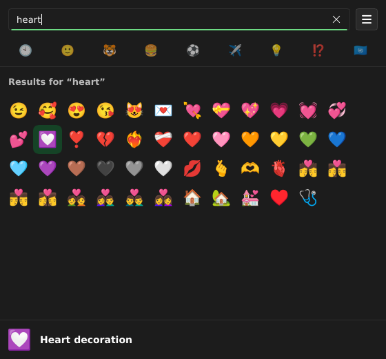

# FastMoji

[](https://github.com/evandro777/FastMoji/actions/workflows/ci.yml)
[](https://github.com/evandro777/FastMoji/actions/workflows/flatpak.yml)

A popup emoji picker for Linux that is **light and fast**. Written in Rust with [Slint](https://slint.dev).

FastMoji is inspired by [Emote](https://github.com/tom-james-watson/Emote) by Tom Watson, a great GTK4 picker. FastMoji keeps the same idea (press a shortcut, search, pick, and the emoji is pasted into the app you were using) and focuses on startup time and memory:

|                              | Emote 4.0.2 (Python + GTK) | FastMoji       |
|------------------------------|----------------------------|----------------|
| Idle memory (resident)       | ~99 MB                     | **~23 MB**     |
| Memory with the picker shown | ~99 MB                     | **~27 MB**     |
| Shortcut to window mapped    | median 130 ms              | **6–12 ms**    |
| Per-keystroke search         | not measured               | **0.2–0.3 ms** |



## Features

- Instant search, 9 categories that follow scrolling, and your recent emojis first
- Keyboard first: arrows (also while typing), `Enter` copy and paste, `Shift+Enter` build a multi-emoji selection, `Ctrl+F` search, `Ctrl+Tab` categories, `Esc` close
- Click copies and pastes, right click adds to the selection
- Skin tone, emoji size and automatic paste preferences
- Global shortcut (default `Ctrl+Alt+E`) on X11
- Optional: **do not stay in memory** (see below)
- Follows the desktop's light/dark theme

## Status

Early pilot. Works on **X11** (tested on Cinnamon): global shortcut, clipboard and automatic paste. On **Wayland** it shows the picker and copies to the clipboard; there is no global shortcut or automatic paste yet (bind a key to `fastmoji --toggle`).

## Install (first time)

Install Rust toolchain and dependencies to build.

Debian/Ubuntu/Mint:

```bash
sudo apt install libfontconfig-dev libxkbcommon-dev libxkbcommon-x11-dev libx11-dev libxcb1-dev rustup`
rustup default stable
```

### How to run

```bash
cargo run --release              # start the daemon and show the picker
cargo build --profile fast       # quick iteration build (no LTO)
cargo test
```

| Command                 | Effect                                                                      |
|-------------------------|-----------------------------------------------------------------------------|
| `fastmoji`              | Show the picker (starts the daemon if needed)                               |
| `fastmoji --toggle`     | Show/hide it. Bind this to a key on Wayland, or use it as your own shortcut |
| `fastmoji --background` | Start without showing a window (autostart)                                  |

### From a release (Flatpak bundle)

Download `FastMoji-<version>-x86_64.flatpak` from the [Releases](https://github.com/evandro777/FastMoji/releases) page, check it against the `.sha256` file, then:

```bash
flatpak install --user ./FastMoji-<version>-x86_64.flatpak
flatpak run io.github.evandro777.FastMoji
```

### Build the Flatpak yourself

App id: `io.github.evandro777.FastMoji`.

```bash
sudo apt install flatpak-builder
flatpak install --user flathub org.freedesktop.Sdk//25.08 org.freedesktop.Sdk.Extension.rust-stable//25.08
flatpak/build.sh --devel      # installs io.github.evandro777.FastMoji.Devel
flatpak run io.github.evandro777.FastMoji.Devel
```

`flatpak/build.sh` without `--devel` builds the real id; `--bundle` also writes `flatpak/fastmoji.flatpak`. Crates are vendored into `flatpak/vendor` (about 700 MB, git-ignored) because the sandboxed build has no network. The sandbox only gets the X11/Wayland sockets. Settings live in `~/.var/app/<app-id>/data/FastMoji/settings.toml`. For a desktop shortcut that runs the Flatpak use the command `flatpak run io.github.evandro777.FastMoji`.

## Configuration

`~/.local/share/FastMoji/settings.toml` (written by the Preferences panel):

```toml
shortcut = "Ctrl+Alt+E"   # X11 global shortcut, applied at start (e.g. "Ctrl+Alt+period", "Super+F2", "Ctrl+Alt+Tab"; keys: letters, digits, F1-F12, Tab, Return, space, period, comma, minus)
keep_resident = true      # see below
auto_paste = true
skin_tone = 0             # 0 = default, 1..5
emoji_size = 28           # 20, 24, 28, 32 or 36
```

### Keeping FastMoji in memory

By default FastMoji stays resident, so it opens instantly and the global shortcut works. In *Preferences → Keep FastMoji in memory* (or `keep_resident = false`) you can turn that off:

- FastMoji exits as soon as the picker is closed, so **the global shortcut no longer works**. Open it with your own desktop shortcut that runs `fastmoji` (for example Super+Y in Cinnamon's keyboard settings).
- After you pick an emoji and it is pasted, FastMoji exits at once. The clipboard then belongs to nobody, so the emoji stays available only if a clipboard manager (CopyQ, ...) keeps it. If nothing was pasted (automatic paste off), FastMoji waits for *your* paste: it exits shortly after another application reads the clipboard (clipboard managers reading it in the first second are ignored), as soon as the clipboard is replaced, or after 5 minutes.
- On Wayland the setting is locked on, because the clipboard needs the process.

### Restarting after a crash

Release builds abort on a panic, so a bug can never leave a half-working process behind, but then the global shortcut stays dead until FastMoji is started again. To have it restarted automatically, run it as a systemd user service instead of a plain autostart entry (`~/.config/systemd/user/fastmoji.service`, then `systemctl --user enable --now fastmoji`):

```ini
[Unit]
Description=FastMoji emoji picker

[Service]
ExecStart=%h/.cargo/bin/fastmoji --background
Restart=on-failure
RestartSec=1

[Install]
WantedBy=graphical-session.target
```

Adjust `ExecStart` to where `fastmoji` is installed (for the Flatpak use `flatpak run io.github.evandro777.FastMoji --background`). Quitting from Preferences is a normal exit and is not restarted. Run with `FASTMOJI_DEBUG=1` or read `journalctl --user -u fastmoji` to see the panic message.

## How it is built

- **Rust + Slint** with the winit backend and the **software renderer** (no GPU/GL context, which is where most of the memory of a toolkit app goes).
- **Emoji drawn as images**: the software renderer cannot draw the bitmap (CBDT) Noto font, so `src/glyphs.rs` shapes each emoji (`rustybuzz`), reads its PNG from the font (`ttf-parser`, `png`) and downsizes it to the exact pixel size it is shown at, so it stays sharp. Only the visible rows are decoded.
- **Emoji data baked in** by `build.rs` from `assets/emojis.csv`; search is a substring match over precomputed lowercase terms.
- **X11 through `x11rb`**: `XGrabKey` hotkey, XTEST Ctrl+V paste (Ctrl+Shift+V when the previous window is a known terminal), EWMH focus hand-over, and a small clipboard owner that knows when another app takes the clipboard.
- **Single instance** through a Unix socket; the daemon shows/hides one window.

See [`AGENTS.md`](AGENTS.md) for the architecture notes and the gotchas learned along the way.

## Contributing and releases

See [`CONTRIBUTING.md`](CONTRIBUTING.md) to build, test and send a change, and [`RELEASING.md`](RELEASING.md) for how a release is cut. CI (format, clippy, tests, packaging checks, and a Flatpak build) runs on every pull request.

## AI assistance

FastMoji was written with substantial help from an AI coding assistant (Claude Code), directed and reviewed by the maintainer. The commit history and `AGENTS.md` reflect that workflow.

## License

GPL-3.0-or-later (see `LICENSE`). Emoji data, the Noto font and libraries are covered in [`THIRD_PARTY.md`](THIRD_PARTY.md). Thanks to Tom Watson and the Emote contributors for the idea.
